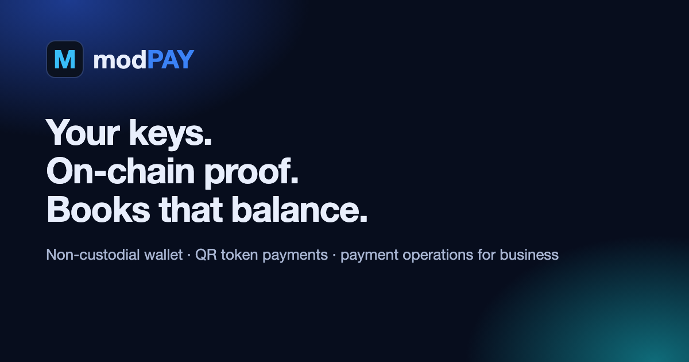
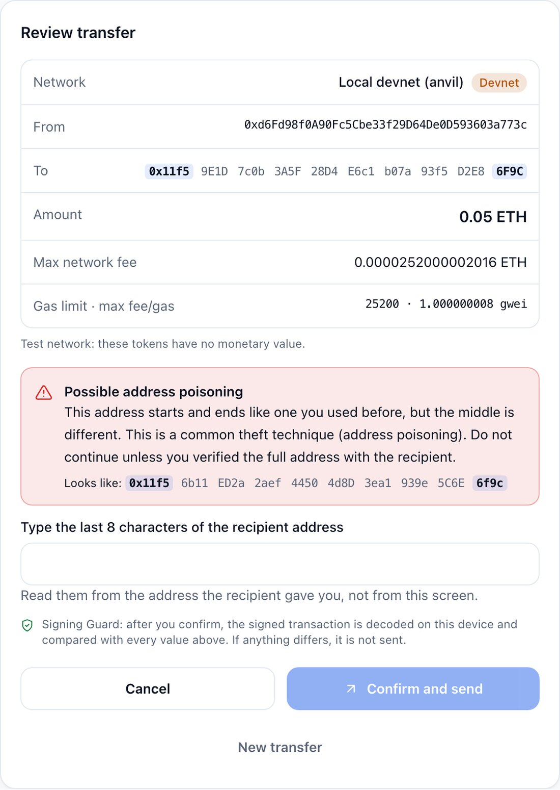
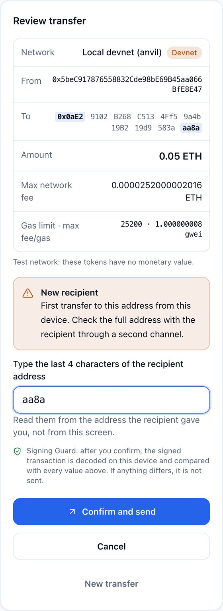
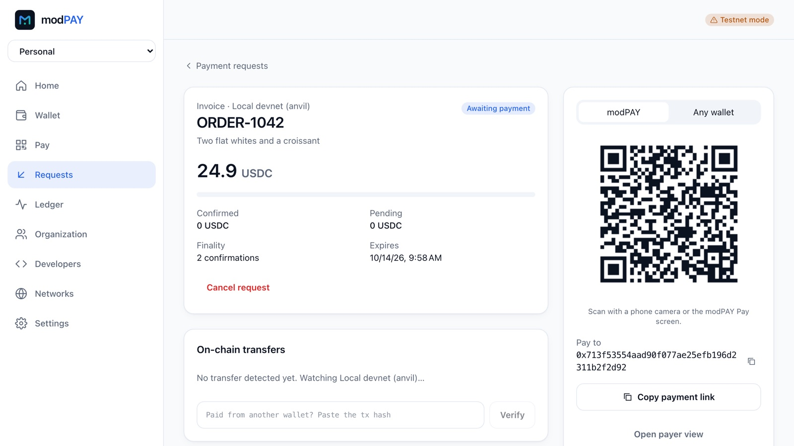
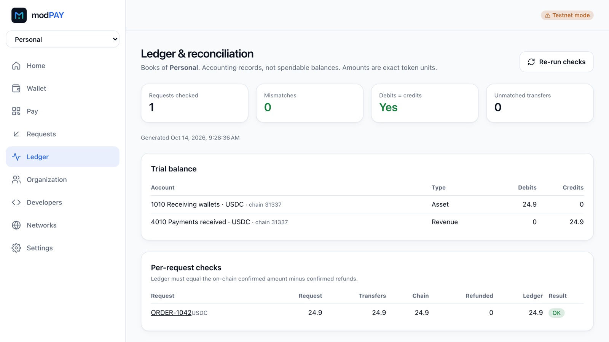
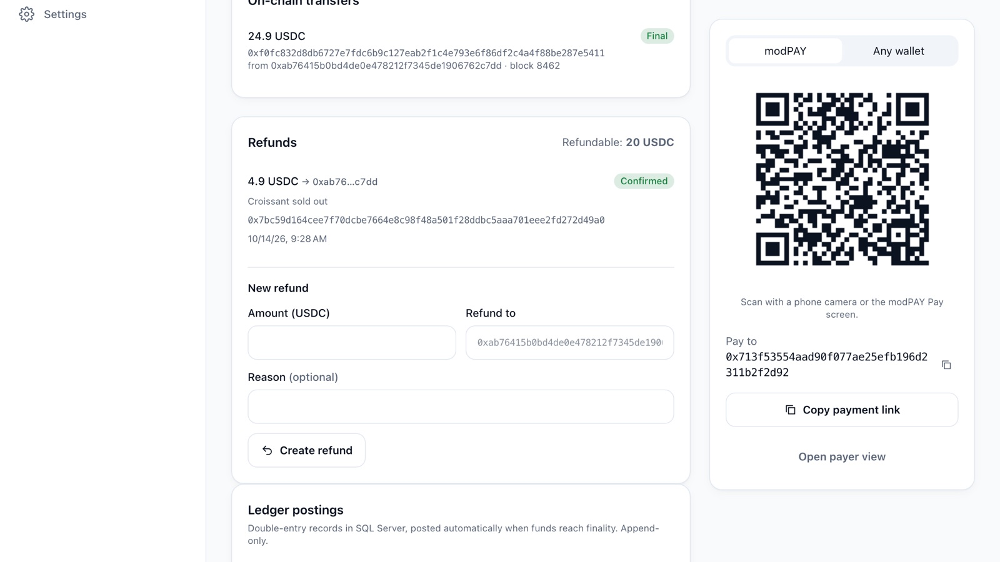
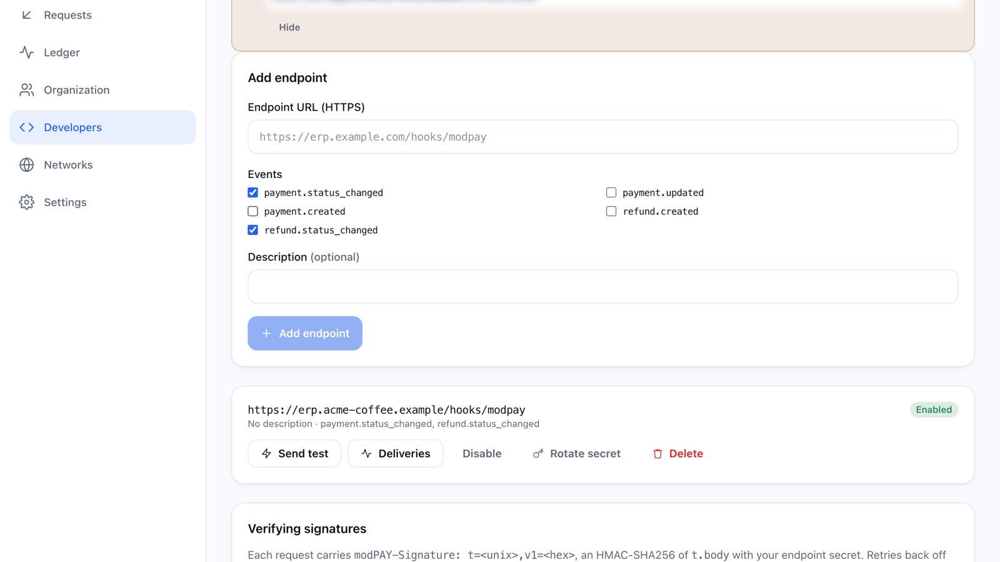

# modPAY — Your keys. On-chain proof. Books that balance.

**modPAY** is a non-custodial digital wallet, QR token-payment infrastructure and business payment-operations platform. Payments are signed in the browser, verified on-chain and posted to an append-only double-entry ledger in SQL Server.

[Website](https://wearetheartmakers.github.io/modPAY/en/) · [**Live demo**](https://modpay.runasp.net) (testnets) · [Intro video](docs/assets/video/modpay-intro.mp4) · [Türkçe](README.md) · [Commercial licensing](COMMERCIAL_LICENSING.md) · **info@wearetheartmakers.com** · +90 505 314 9360

> This repository is the product page of modPAY; it contains no source code. modPAY is proprietary software of WATAM, licensed under a written agreement. Live on test networks.

## The story: keeping keys safe is not enough

> **Is securing digital assets only about storing private keys? Or is the real question how transactions are authorized, verified and recorded?**

In early 2025, about 1.5 billion dollars were taken from a major exchange's cold wallet. No private key was stolen: the signers approved a transaction that looked routine on screen, but the data they signed handed control of the wallet to the attacker. Every day, assets are lost the same way, to "poisoned" lookalike addresses and unlimited token approvals.

That thought shaped modPAY: **your keys stay with you**, **you sign what you see** (*Signing Guard* decodes the signed transaction on the device and compares it field by field with the screen; any difference and nothing is sent; the wallet signs plain transfers only) and **nothing is booked until the chain confirms it**. No extra step for verified merchants and known addresses; a first-time recipient asks for the last 4 characters, a lookalike for 8.

 

## Why modPAY?

| | |
|---|---|
| **Signing Guard** | The signed transaction is decoded on the device and compared with the screen (network, recipient, amount, token, fee, signer); any difference and it is not sent. No token approvals or hidden calls are signed; address-poisoning warnings. |
| **Keys stay with the user** | Recovery phrases and private keys never leave the browser: encrypted on the device with Argon2id + AES-256-GCM. The server sees only signed transactions and public addresses. No administrator can access keys. |
| **QR payments** | The merchant enters an amount and gets a QR code. The customer scans it in modPAY or any EVM wallet such as MetaMask (EIP-681), reviews fee and recipient, and confirms. ETH, BNB, USDC and USDT on Ethereum, **BNB Smart Chain**, Polygon and Arbitrum testnets. |
| **"Paid" means on-chain** | A payment becomes *Confirmed* only when the transfer is found on-chain with the network's confirmation depth — never because a payer says so. Reorgs, partial, over- and late payments get their own states. |
| **Accounting-ready** | Every final payment posts a double-entry record in SQL Server (Dr 1010 / Cr 4010). Ledger rows cannot be edited (database triggers); reconciliation compares requests, transfers, chain observations and the ledger. Payment requests and the journal export to CSV for accounting/ERP with exact amounts. |
| **Refunds** | The merchant signs refunds in their own wallet; a refund is booked (Dr 4090 / Cr 1010) only after the exact transfer is verified on-chain. |
| **Teams and integrations** | Organizations with Owner/Admin/Finance/Viewer roles and email invitations; HMAC-signed webhooks to your ERP; authenticator-app 2FA. |
| **Multi-network checkout** | One invoice payable on several networks; the customer picks the network they hold funds on and the first payment closes the others. Same asset or USD stablecoins (USDC/USDT 1:1); no bridge, no FX risk. Networks: Ethereum, BNB Smart Chain, Avalanche C-Chain, Polygon, Arbitrum (testnets). |
| **KVKK / GDPR** | Users can erase their own account (personal data anonymized, financial records kept for legal retention); privacy notice, terms and cookie notice in the app. Strictly necessary cookies only. |
| **Enterprise stack** | .NET 10, Angular, SQL Server, RabbitMQ, Redis, Hangfire; Docker and Kubernetes (Helm). |

<table>
  <tr>
    <td width="50%"> <strong>Payment request and QR.</strong> modPAY link or EIP-681 for any wallet.</td>
    <td width="50%"> <strong>Ledger and reconciliation.</strong> Zero mismatches, debits = credits.</td>
  </tr>
  <tr>
    <td width="50%"> <strong>Refunds.</strong> Signed in the browser, verified on-chain.</td>
    <td width="50%"> <strong>Webhooks.</strong> Signed events, delivery log.</td>
  </tr>
</table>

## How it works

1. The merchant creates a payment request; a unique amount and an expiry are assigned and a QR code is generated.
2. The customer scans it, reviews the network fee and recipient, and confirms; the transaction is signed on their device.
3. The worker finds the transfer on-chain (ERC-20 logs plus block scanning for native transfers) and counts confirmations.
4. At the required depth the request becomes *Confirmed*; the ledger posting, outbox event and webhook are produced in one transaction.

## Technology

Angular 22 · TypeScript · PWA · C# / ASP.NET Core (.NET 10) · Microsoft SQL Server · Entity Framework Core · Dapper · ADO.NET · RabbitMQ · Redis · Hangfire · SignalR · Docker · Kubernetes/Helm · GitHub Actions · Azure Pipelines. Tested with 61 domain and 32 SQL Server integration tests, 36 frontend unit tests and Playwright end-to-end runs on desktop and mobile with real signing, broadcasting and on-chain confirmation.

## Status and limits

- Test networks (Sepolia, BNB Smart Chain Testnet, Avalanche Fuji, Polygon Amoy, Arbitrum Sepolia) and a local devnet are enabled; **mainnet broadcasting is disabled**.
- **Compliance readiness:** controls mapped to SOC 2 and ISO/IEC 27001:2022 with evidence. No card data → outside PCI DSS scope.
- modPAY is not a bank, payment institution, exchange or custodian; live use with real assets requires the customer's own legal and regulatory assessment.

## Contact

Sales and support: **info@wearetheartmakers.com**, **+90 505 314 9360**. Security reports: **admin@wearetheartmakers.com** ([security policy](SECURITY.md)).

© 2026 WATAM — We Are The Art Makers. All rights reserved.
