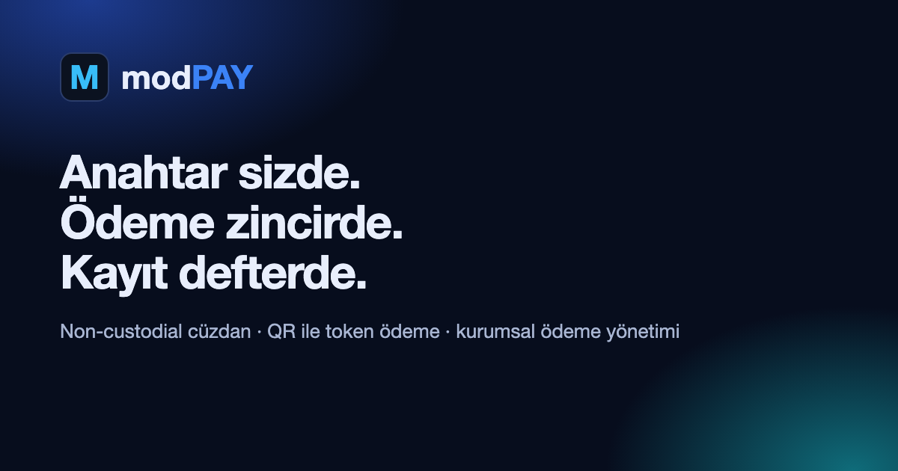
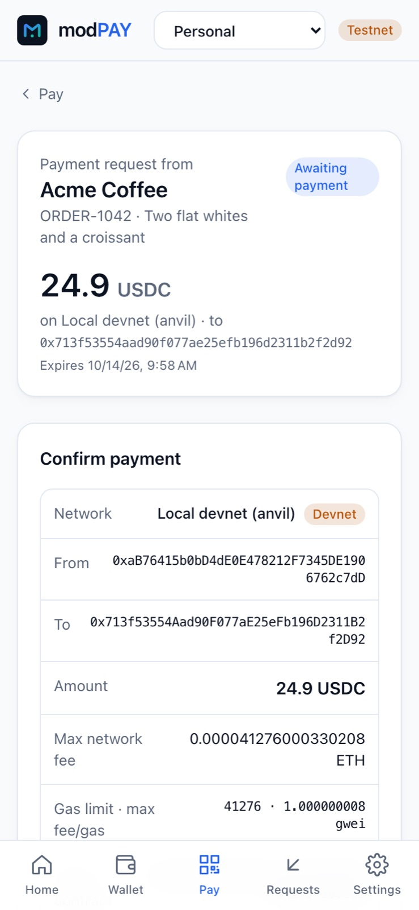
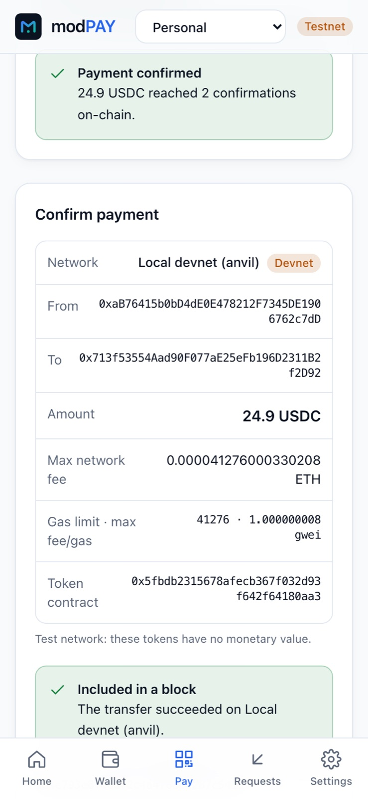

<p align="center"><a href="https://wearetheartmakers.github.io/modPAY/"></a></p>

# modPAY — Anahtar sizde, ödeme zincirde, kayıt defterde.

**modPAY**, kendi anahtarınızı tuttuğunuz (non-custodial) bir dijital cüzdan, QR ile token ödeme altyapısı ve kurumsal finansal işlem yönetimi platformudur. Ödeme tarayıcıda imzalanır, zincirde doğrulanır ve SQL Server'da çift taraflı, değiştirilemez bir deftere işlenir.

[Tanıtım sitesi](https://wearetheartmakers.github.io/modPAY/) · [**Canlı demo**](https://modpay.runasp.net) (test ağları) · [Tanıtım videosu](docs/assets/video/modpay-intro.mp4) · [English](README.en.md) · [Ticari lisans](COMMERCIAL_LICENSING.md) · **info@wearetheartmakers.com** · +90 505 314 9360

> Bu depo modPAY'in tanıtım sayfasıdır; yazılımın kaynak kodunu içermez. modPAY, WATAM'ın tescilli ürünüdür ve lisansla kullanılır. Şu an **test ağlarında** canlıdır; güvenlik incelemesi tamamlandı ve bulgular düzeltildi, ana ağ üçüncü taraf denetimi sonrası açılır.

## Hikâye: anahtarı saklamak yetmiyor

> **Dijital varlıkları güvence altına almak, yalnızca özel anahtarları saklamaktan mı ibaret? Yoksa asıl mesele, işlemlerin nasıl yetkilendirildiği, doğrulandığı ve kaydedildiği mi?**

2025'in başında büyük bir kripto borsasının soğuk cüzdanından yaklaşık 1,5 milyar dolarlık varlık çalındı. Özel anahtarlar çalınmadı; imzacılar ekranda olağan görünen bir işlemi onayladı, ama imzaladıkları veri cüzdanın kontrolünü saldırgana devrediyordu. Her gün benzer şekilde, "zehirli" benzer adreslere ya da sınırsız token onaylarına imza atılarak varlık kaybediliyor.

Bu düşünce modPAY'in şekillenmesine katkı sağladı: **anahtar sizde**, **ne gördüyseniz onu imzalarsınız** (*İmza Koruması*: imzalanan işlem cihazda çözülür ve ekrandakiyle alan alan karşılaştırılır; fark varsa gönderilmez; cüzdan yalnızca düz transfer imzalar) ve **zincirde doğrulanmadan kayıt yok**. Doğrulanmış satıcıya ve bilinen adreslere ek adım yoktur; yeni alıcıda adresin son 4, benzer (zehirli) adreste son 8 karakteri istenir.

<p align="center"> </p>

<sub>modPAY çalınmış varlıkları geri getirmez ve yaşanmış bir saldırıyı önleyeceğini iddia etmez. İmza Koruması donanım cüzdanda ekranda doğrulamanın ve bağımsız denetimin yerini tutmaz.</sub>

## Neden modPAY?

| | |
|---|---|
| **İmza Koruması** | İmzalanan işlem cihazda çözülür; ağ, alıcı, tutar, token, ücret ve imzacı ekrandakiyle karşılaştırılır, fark varsa gönderilmez. Token onayı ve gizli kontrat çağrısı imzalanmaz; adres zehirlemeye karşı uyarı. |
| **Anahtar kullanıcıda** | Kurtarma ifadesi ve özel anahtarlar tarayıcıdan hiç çıkmaz: Argon2id + AES-256-GCM ile şifrelenip cihazda saklanır. Sunucu yalnızca imzalı işlemi ve herkese açık adresleri görür. Yöneticiler dahil kimse anahtarlara erişemez. |
| **QR ile ödeme** | Satıcı tutarı girer, QR çıkar. Müşteri modPAY'de ya da MetaMask gibi herhangi bir EVM cüzdanında (EIP-681) okutur, ücreti ve alıcıyı görüp onaylar. Ethereum, **BNB Smart Chain**, Polygon ve Arbitrum test ağlarında ETH, BNB, USDC ve USDT. |
| **"Ödendi" demek için zincir şart** | Bir ödeme, ödeyenin "ödedim" demesiyle değil, transfer zincirde bulunup ağın onay derinliğine ulaşınca *Onaylandı* olur. Reorg, eksik/fazla/geç ödeme ayrı durumlara düşer. |
| **Muhasebeye hazır** | Her kesinleşen ödeme SQL Server'da otomatik çift taraflı kayıt üretir (Dr 1010 / Cr 4010). Kayıtlar veritabanı tetikleyicisiyle değiştirilemez; mutabakat raporu talep, transfer, zincir gözlemi ve defteri karşılaştırır. Ödeme talepleri ve yevmiye kayıtları tam hassasiyetle CSV olarak muhasebe/ERP'ye aktarılır. |
| **İade** | Satıcı iadeyi kendi cüzdanında imzalar; iade, tam tutar zincirde doğrulanınca deftere işlenir (Dr 4090 / Cr 1010). |
| **Ekip ve entegrasyon** | Organizasyonlar ve roller (Sahip, Yönetici, Finans, İzleyici), e-posta daveti; ERP'nize HMAC imzalı webhook'lar; iki adımlı doğrulama. |
| **Çok ağlı ödeme** | Tek fatura birden fazla ağda ödenebilir; müşteri varlığının olduğu ağı seçer, ilk ödeme diğer seçenekleri kapatır. Aynı varlık ya da USD stabil koinler (USDC/USDT 1:1); köprü ve kur riski yok. Ağlar: Ethereum, BNB Smart Chain, Avalanche C-Chain, Polygon, Arbitrum (test ağları). |
| **KVKK / GDPR** | Kullanıcı hesabını kendisi silebilir (kişisel veriler anonimleştirilir, mali kayıtlar yasal saklama için korunur); aydınlatma metni, kullanım koşulları ve çerez bilgisi uygulamada. Yalnızca zorunlu çerezler. |
| **Kurumsal altyapı** | .NET 10, Angular, SQL Server, RabbitMQ, Redis, Hangfire; Docker ve Kubernetes (Helm). Küçük kurulumlar için tek süreçli **Lite** paketi (Redis/RabbitMQ gerekmez, ~120 MB bellek). |

<table>
  <tr>
    <td width="50%"><br><strong>Ödeme talebi ve QR.</strong> modPAY bağlantısı ya da her cüzdan için EIP-681.</td>
    <td width="50%"><br><strong>Defter ve mutabakat.</strong> Sıfır uyumsuzluk, borç = alacak.</td>
  </tr>
  <tr>
    <td width="50%"><br><strong>İade.</strong> Tarayıcıda imzalanır, zincirde doğrulanır.</td>
    <td width="50%"><br><strong>Webhook'lar.</strong> İmzalı olaylar, teslimat günlüğü.</td>
  </tr>
</table>

<p align="center"> </p>

## Nasıl çalışır?

```
 Telefon / tarayıcı (Angular PWA)             Sunucu (.NET 10)                        Veri
 ┌────────────────────────────┐  imzalı tx   ┌──────────────────────────┐  EF Core   ┌─────────────────┐
 │ Cüzdan: BIP-39/44, viem    │ ───────────▶ │ API: kimlik, ödeme,      │ ─────────▶ │ SQL Server      │
 │ Şifreli kasa (IndexedDB)   │  (anahtar    │ defter, organizasyon     │  Dapper    │ defter (append- │
 │ QR okuma / EIP-681         │   gitmez)    ├──────────────────────────┤  ADO.NET   │ only), outbox   │
 └─────────────┬──────────────┘              │ Worker: zincir izleyici, │            └─────────────────┘
               │ SignalR ◀─ RabbitMQ ◀─ outbox│ webhook, Hangfire        │   Redis: lider kilidi
               ▼                              └────────────┬─────────────┘
        EVM test ağları (Sepolia, Amoy, Arbitrum Sepolia) ◀┘ log + blok tarama, onay ve reorg takibi
```

1. Satıcı ödeme talebi oluşturur; benzersiz tutar ve son kullanma zamanı atanır, QR üretilir.
2. Müşteri QR'ı okutur, ağ ücretini ve alıcıyı inceler, açıkça onaylar; işlem cihazında imzalanır.
3. Worker transferi zincirde bulur (ERC-20 logları ve native transferler için blok tarama), onayları sayar.
4. Onay derinliğine ulaşınca durum *Onaylandı* olur; defter kaydı, outbox olayı ve webhook aynı işlemde üretilir.

## Teknoloji

| Katman | Kullanılanlar |
|---|---|
| Frontend | Angular 22, TypeScript, Tailwind, PWA, viem, SignalR, katı CSP |
| Backend | C#, ASP.NET Core (.NET 10), Minimal API, ASP.NET Core Identity, FluentValidation |
| Veri | Microsoft SQL Server, Entity Framework Core (migration), Dapper, ADO.NET; append-only defter tetikleyicileri |
| Mesajlaşma ve işler | RabbitMQ (transactional outbox, publisher confirms), Redis (lider kilidi), Hangfire |
| Dağıtım | Docker (chiseled, root olmayan imajlar), Kubernetes + Helm, GitHub Actions ve Azure Pipelines |
| Test | 61 domain + 32 gerçek SQL Server entegrasyon testi, 36 frontend birim testi, masaüstü ve mobilde Playwright uçtan uca testler (gerçek imza, yayın ve zincir onayı) |

## Belgeler

- [Mimari ve teknoloji](docs/guides/mimari.md)
- [Güvenlik modeli](docs/guides/guvenlik.md)
- [Webhook entegrasyonu](docs/guides/webhooks.md)
- [Kurulum ve işletim (Docker, Kubernetes)](docs/guides/kurulum.md)
- [Ürün özeti](docs/sales/urun-ozeti.md) · [Pilot ve kabul](docs/sales/pilot-ve-kabul.md)
- [Sürüm notları](CHANGELOG.md)

## Durum ve sınırlar

- Test ağları (Sepolia, BNB Smart Chain Testnet, Avalanche Fuji, Polygon Amoy, Arbitrum Sepolia) ve yerel devnet etkin; **ana ağda işlem gönderimi kapalıdır**.
- **E-ticaret API'si ve kasa ekranı:** API anahtarlarıyla sunucudan fatura, ödeme sonrası mağazaya dönüş; POS ekranında tek QR.
- **Uyum hazırlığı:** kontroller SOC 2 ve ISO/IEC 27001:2022 ile eşlendi (kanıtlarıyla); sertifika bağımsız denetimle alınır. Kart verisi işlenmez → PCI DSS kapsamı dışında. Ana ağ, bağımsız güvenlik denetimi tamamlanana kadar kapalı.
- modPAY bir banka, ödeme kuruluşu, borsa ya da saklayıcı değildir; gerçek varlıklarla kullanım, müşterinin hukuki ve düzenleyici değerlendirmesini gerektirir.

## İletişim

Satış ve destek: **info@wearetheartmakers.com**, **+90 505 314 9360**. Güvenlik bildirimleri: **admin@wearetheartmakers.com** ([güvenlik politikası](SECURITY.md)).

© 2026 WATAM — We Are The Art Makers. Tüm hakları saklıdır.
